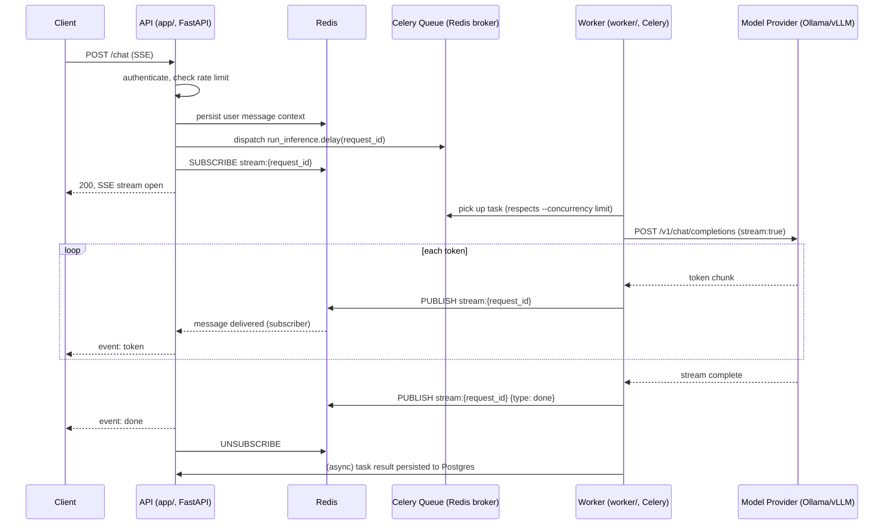
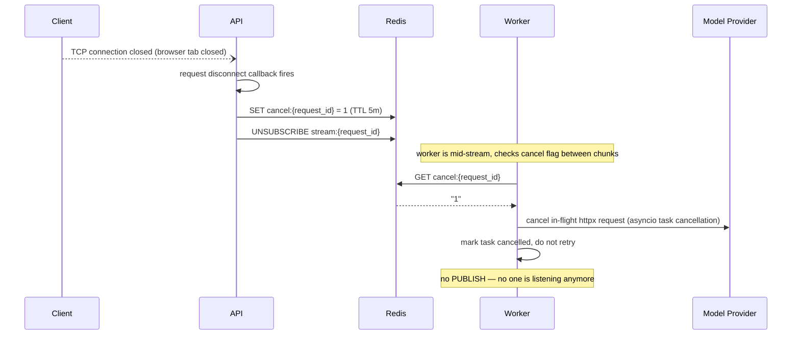
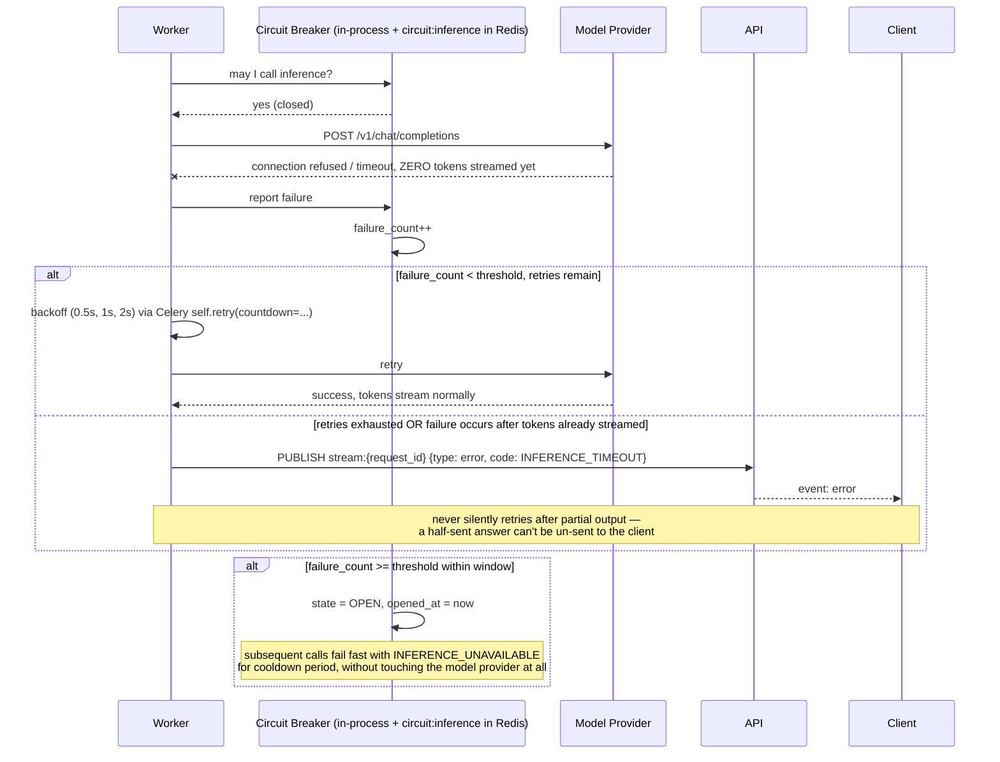
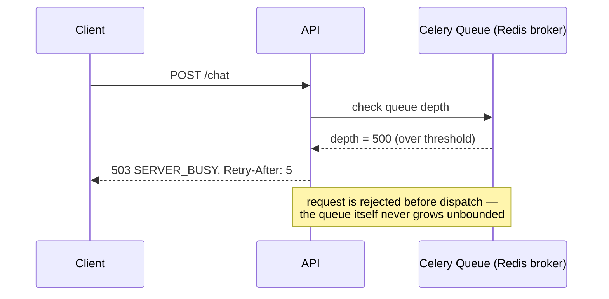
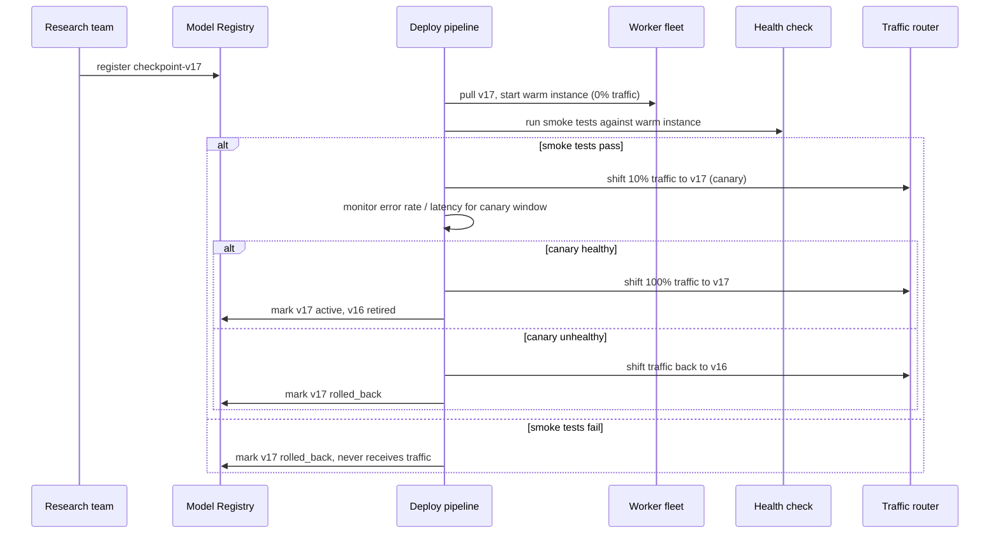

# Aurora — Sequence Diagrams

## 1. Happy path: chat request with streaming

## 2. Client disconnect / cancellation

Cancellation is checked *between* chunks, not via a blocking call — the worker's async read loop already yields control per-token, so this is a cheap poll, not a new concurrency primitive. It deliberately does **not** use Celery's `task.revoke(terminate=True)` — in the default prefork pool that sends `SIGTERM` to the entire worker process, killing every other task it might be running, not just this one.

## 3. Inference failure: retry vs. fail-loud

The load-bearing rule here, worth stating out loud in an interview: **retries are only safe before the first byte of output has reached the client.** Once tokens are streaming, a failure becomes a terminal `error` event, never a silent retry — because the client has already rendered partial output it can't be told to un-render.

## 4. Backpressure: queue is full

## 5. Checkpoint deployment

Detailed in `DEPLOYMENT.md`; this diagram is the one-page version.
