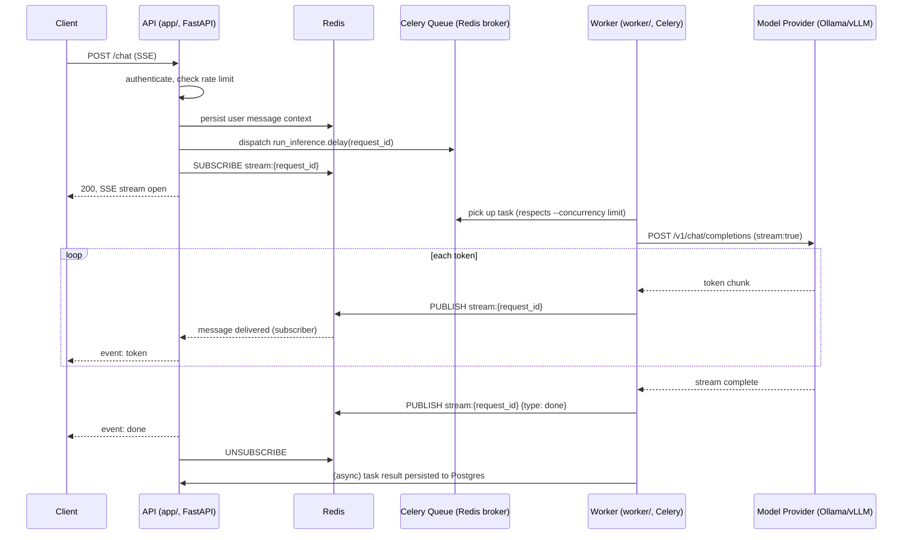
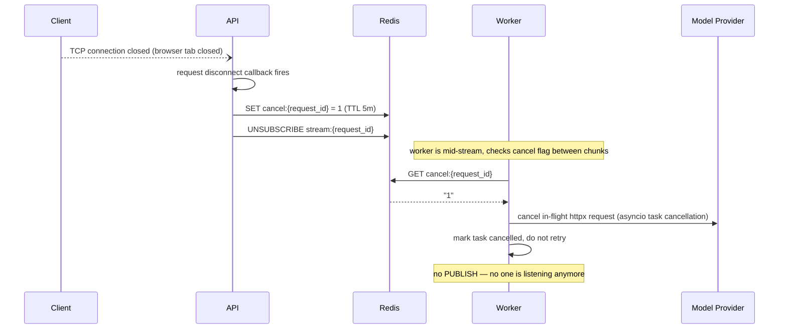
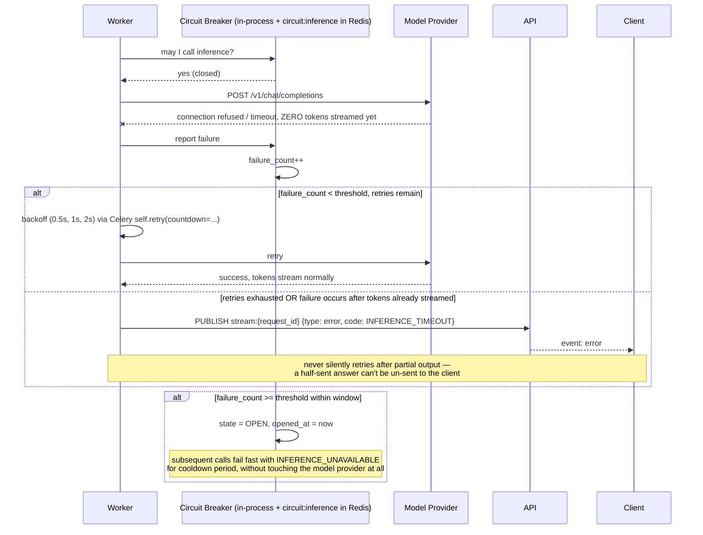
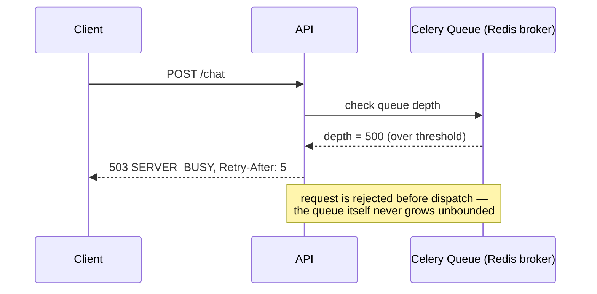
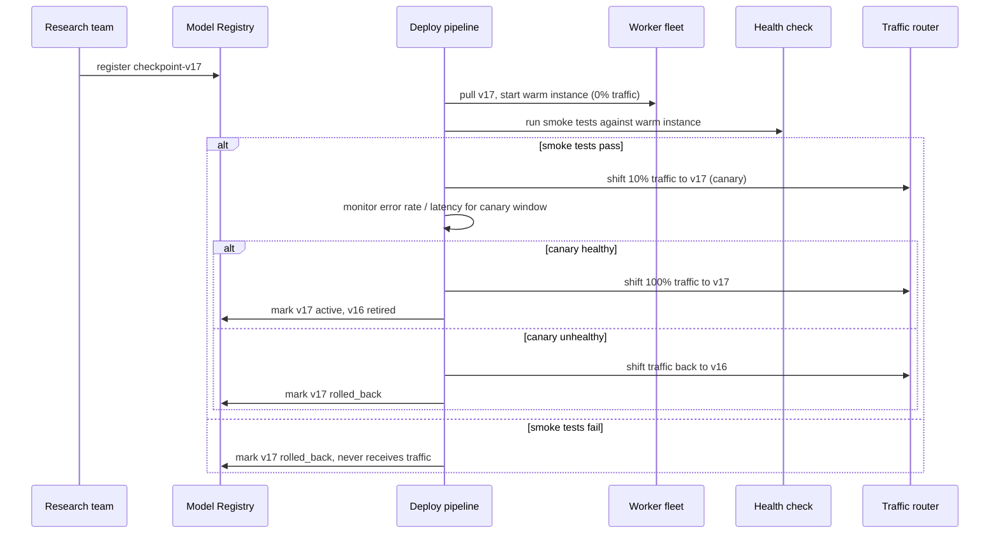

# Aurora —— 时序图（中文版）

> 本文档是 [`docs/SEQUENCE_DIAGRAMS.md`](../../SEQUENCE_DIAGRAMS.md) 的中文翻译，仅用于学习，内容以英文原版为准。Mermaid 图表本身保留英文原文（参与者名称、消息文本），避免翻译破坏图表渲染；图表下方的说明文字翻译为中文。

## 1. 正常路径：带流式传输的聊天请求

参与者对照：C = 客户端，A = API（app/，FastAPI），R = Redis，Q = Celery 队列（Redis 作 broker），W = Worker（worker/，Celery），O = 模型 Provider（Ollama/vLLM）。

流程翻译：客户端发起 `POST /chat`（SSE）→ API 完成认证、限流检查 → API 把用户消息上下文持久化到 Redis → API 派发任务 `run_inference.delay(request_id)` → API 订阅 `stream:{request_id}` 频道 → API 向客户端返回 200，SSE 流开启 → Worker 捞起任务（遵守 `--concurrency` 限制）→ Worker 向模型 Provider 发起流式请求 → 每收到一个 token，Worker 就把它 `PUBLISH` 到 `stream:{request_id}`，Redis 把消息投递给订阅者（API），API 再把它转发成一个 `event: token` 事件给客户端 → 流结束后，Worker 发布一条 `{type: done}` 消息，API 转发 `event: done` 给客户端，并取消订阅 → Worker（异步地）把任务结果持久化到 Postgres。

## 2. 客户端断开连接 / 取消请求

流程翻译：客户端的 TCP 连接被关闭（比如浏览器标签页被关掉）→ API 这边的断线回调被触发 → API 在 Redis 里设置 `cancel:{request_id} = 1`（TTL 5 分钟）→ API 取消订阅 `stream:{request_id}` → （此时 Worker 正在流式输出过程中，会在每个 chunk 之间检查取消标志位）→ Worker 读取 `cancel:{request_id}`，读到 `"1"` → Worker 取消正在进行中的 httpx 请求（通过 asyncio 任务取消机制）→ Worker 把任务标记为已取消，不再重试。（这时不会再有任何 `PUBLISH` 操作——反正也没有人在监听了。）

取消检查发生在 chunk *之间*，而不是通过一个阻塞调用来实现——worker 的异步读取循环本来在每个 token 之间就会让出控制权，所以这只是一次低成本的轮询，不需要引入新的并发原语。这里刻意**不**使用 Celery 的 `task.revoke(terminate=True)`——在 Celery 默认的 prefork 进程池模型下，`terminate=True` 会给整个 worker 进程发 `SIGTERM`，把这个 worker 上可能正在运行的其他任务也一起杀掉，而不只是这一个。

## 3. 推理失败：重试还是直接报错

流程翻译：Worker 问熔断器"我现在能调用推理吗？"→ 熔断器回答"可以（关闭状态）"→ Worker 向模型 Provider 发起请求 → 连接被拒绝/超时，**此时还没有任何 token 被流式发出**→ Worker 向熔断器上报这次失败 → 熔断器的失败计数 +1。

如果失败次数还没到阈值、且还有重试次数剩余：Worker 按 Celery 的 `self.retry(countdown=...)` 机制退避（0.5 秒、1 秒、2 秒），然后重试，这次模型 Provider 成功响应，token 正常流式返回。

否则（重试次数已耗尽，或者失败发生在 token 已经开始流式输出之后）：Worker 向 API 发布一条 `{type: error, code: INFERENCE_TIMEOUT}` 消息，API 转发一个 `event: error` 给客户端。（图中注释：一旦有部分输出发出去了，就绝不会悄悄重试——一个发送了一半的答案，没办法通知客户端"撤回"。）

另外，如果失败次数在窗口期内达到了阈值：熔断器状态切换为 `OPEN`，记录 `opened_at = now`。（图中注释：在冷却期内，后续调用会直接以 `INFERENCE_UNAVAILABLE` 快速失败，完全不会去碰模型 provider。）

这里最核心、最值得在面试里能脱口而出的一条规则是：**只有在还没有任何一个字节的输出到达客户端之前，重试才是安全的。** 一旦 token 已经开始流式传输，任何失败都会变成一个终态的 `error` 事件，绝不会是一次悄悄的重试——因为客户端已经把部分输出渲染出来了，没办法让它"取消渲染"。

## 4. 背压：队列满了

流程翻译：客户端发起 `POST /chat` → API 检查队列深度 → 队列返回当前深度 500（超过阈值）→ API 直接向客户端返回 `503 SERVER_BUSY`，带 `Retry-After: 5`。（图中注释：请求在派发之前就被拒绝了——队列本身永远不会无限增长。）

## 5. Checkpoint 部署

参与者对照：R = 研究团队，Reg = 模型注册中心，D = 部署流水线，W = Worker 集群，H = 健康检查，T = 流量路由器。

流程翻译：研究团队向注册中心登记 `checkpoint-v17` → 部署流水线让 Worker 集群拉取 v17、启动一个预热实例（0% 流量）→ 部署流水线对预热实例跑冒烟测试。如果冒烟测试通过：把 10% 的流量切给 v17（金丝雀发布），监控这部分金丝雀流量在观察窗口内的错误率/延迟；如果金丝雀健康，就把 100% 流量切到 v17，并把 v17 标记为 active、v16 标记为 retired；如果金丝雀不健康，就把流量切回 v16，把 v17 标记为 rolled_back。如果冒烟测试没通过：直接把 v17 标记为 rolled_back，它永远不会收到任何流量。

详细内容见 `DEPLOYMENT.md`；这张图是它的一页纸精简版。
